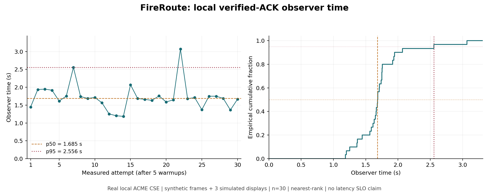

# FireRoute local observer measurement

Measured 2026-11-15 with the actual local ACME 2026.5.1 CSE and Python 3.12.16 on x86_64. This is a sequential synthetic baseline with three independent simulated displays. MEC, browser rendering and synchronized physical sensor-to-device latency were not measured.

## Results

All five warmups and 30 measured attempts completed. Neither phase had an incomplete, failed or unattempted observation. Warmups are retained in the data but excluded from the following statistics. This observed completion ratio is not an availability guarantee.

| Observer metric | N | p50 (ms) | p95 (ms) | Minimum (ms) | Maximum (ms) |
|---|---:|---:|---:|---:|---:|
| Verified three-device ACKs, Observer_verified_all_acks_ms | 30 | 1684.876 | 2556.166 | 1184.537 | 3069.904 |
| Public-status commit, Observer_pipeline_commit_ms | 30 | 2037.361 | 3109.567 | 1257.716 | 3145.644 |

Including warmups, the real protocol artifacts contain 35 source CINs/read-backs/accepted SUB events, 35 Group/fanOutPoint operations, 105 member command CINs and 105 independently device-written/read-back/notified ACK CINs. The measured subset accounts for 30 deliveries and 90 ACKs. A Group success response alone does not satisfy this result.

The plot shows the primary metric only, with nearest-rank percentile lines and no smoothing. Download the [SVG](assets/t31-observer-latency.svg) or [CSV](assets/t31-observer-latency.csv). The CSV preserves all 35 attempts and integer-nanosecond durations for both metrics; warmups are excluded from the plot. Assets were exported with locally available Matplotlib 3.5.1; no application/runtime dependency was added.

## Measurement boundary and workload

One coordinator uses perf_counter_ns, implemented here by clock_gettime(CLOCK_MONOTONIC), with a reported 1 ns resolution, monotonic=true and adjustable=false. Reported resolution is not a statement of measurement accuracy. All checkpoints use the same run/PID clock domain.

The common start is immediately before ScenarioSession.accept_raw submits a synthetic source frame. The primary end is the return of the original DeliverySession.dispatch, after real CSE writes/read-backs, notification handling, model computation, result persistence, Group fan-out, independent ACK verification, device-state checks and native evidence journaling. The secondary end additionally includes public-status CIN persistence. These are cumulative durations from the same start; subtracting their percentiles does not give the percentile of status-write cost.

Observer polling, verification and native log/storage overhead are included. Bootstrap, final report generation and browser polling/rendering are excluded. The primary endpoint occurs after ACK verification, not at raw third-callback arrival. Device UTC timestamps are not subtracted: cross-host clock offsets/uncertainty are unmeasured, and E2E_all_acks_ms remains null.

The unchanged source engine exports seed 2026, wind 5 m/s, simulated seconds 0–34. One frame is outstanding at a time. Frames and the 170 assumed residents change as the model advances; retained inbox state grows. The population, geometry and behavior remain explicitly uncalibrated assumptions. This is one local development run, not a hazard/load/concurrency, remote-network, physical-sensor or MEC benchmark. Host resource utilization and browser timing were not captured by this gate. No latency SLO, safety validity or MEC performance advantage is claimed.

Percentiles sort successful measured integer-nanosecond durations and select x[ceil(p*N)-1], rounding to three decimal milliseconds only afterward. With N=30, p50 selects rank 15 and p95 rank 29. Failed/incomplete outcomes would remain counted and excluded from successful percentiles; zero successful observations would produce null statistics.

## Provenance and reproduction

Original private run: evidence/20261115-123305Z-389f0ade/. Separate read-only review: evidence/20261115-124131Z-a59ba704/, 23 checks PASS. The review independently recalculates raw ticks, checks actual HTTP/RSC/request correlations and source/SUB/Group/device identities across 848 coordinator and 324 device wire records, and hashes original artifacts. It is not another CSE execution. The original report and independent recalculation agree exactly. The supplied terminal separately reports runner/CSE exit 0 and completed shutdown; this review did not perform Docker inspection.

| Provenance | SHA-256 |
|---|---|
| Executed source manifest | f9a59084a91f788c43b8e1790538a9a5b97d797fea4bacd7e25c41cbb5cfb8b0 |
| Unchanged original engine bundle | 63ae8e4226d5865ff58a0b4cd5657fb06fbe71d16c2e7ad5a9e4208f0f622371 |
| Dedicated 35-frame trace | 9666b91419e1da57d1c1d1480af6f8ec5769f03720c2b554c241199ce55efca8 |
| CSE configuration fingerprint | c8a7e15ae9b03326c30fd350c077c1f21e66c9b757b33c0227dc52f6ca68b574 |

The local standalone IN-CSE uses the verified acme-2026.5.1-shutdown-state-guard-v1 adapter. It is not an MN-CSE deployed on a MEC platform. Raw evidence and credentials stay outside Git; the CSV/figure are curated derived publication assets. See [STATUS](STATUS.md) for the unit and regression checkpoints and [TEST_PLAN](TEST_PLAN.md) for acceptance criteria.

~~~bash
# Requires the documented Docker/Node environment; interrupts this local test stack.
make p1-latency

# Read-only statistics recalculation; replace the path with your own printed run ID.
python3 -m tests.integration.latency_report evidence/20261115-123305Z-389f0ade
~~~

A fresh run should preserve the declared workload, counts and correlations; its durations may differ. The original private path exists only on the measuring workstation. A successful statistics recalculation validates its inputs/math, and requires separate actual wire/device evidence to establish a real-CSE result.

## Later acceptance repeat — separate run

The 19-stage worktree acceptance evidence/20261115-164139Z-e3f6e93b/ executes the same declared 5-warmup/30-measured observer gate at evidence/20261115-164749Z-8c4b5abd/. All 35 attempts complete. These are additional observations, not replacements for the original CSV/figure above.

| Observer metric | N | p50 (ms) | p95 (ms) | Minimum (ms) | Maximum (ms) |
|---|---:|---:|---:|---:|---:|
| Verified three-device ACKs | 30 | 557.233 | 740.982 | 402.879 | 750.627 |
| Public-status commit | 30 | 646.685 | 827.376 | 488.029 | 843.810 |

Read-only acceptance review evidence/20261115-165511Z-77d52c9a/ independently recalculates both percentiles from the measured integer-nanosecond ticks and matches the original report/primary summary. This arithmetic review and the executed integration gate are distinct proof. The acceptance runtime/test manifest is 98388db705480e81fe497a65590770ad9d1da06a14e70bd06341a0cd72f5c647. Host utilization and comparable clock/environment uncertainty remain unmeasured; this was not a controlled optimization experiment. Do not combine runs into one percentile, redraw the original chart as this run, or claim the lower values prove a speedup/SLO, browser latency or MEC advantage. Preserve the same observer/E2E limitations above.

## Clean-commit acceptance repeat — separate run

Clean efc65cb acceptance evidence/20261116-044349Z-18300187/ runs the observer gate at .runtime/releases/20261116-044349Z-18300187/evidence/20261116-045034Z-9facd898/. All five warmups and 30 measured attempts complete, with no failed/incomplete/unattempted observations. Runtime/test manifest: 4d5319f108a3bc41a873cde03527a6cd9a6b0f1771d361fdbf0e5ec52817fd9d.

| Observer metric | N | p50 (ms) | p95 (ms) |
|---|---:|---:|---:|
| Verified three-device ACKs | 30 | 568.133 | 793.534 |
| Public-status commit | 30 | 661.692 | 863.187 |

Separate read-only review evidence/20261116-045734Z-5454a876/ reproduces these nearest-rank statistics from raw integer ticks. The original CSV/figure and worktree repeat above remain unchanged and are not pooled with this run. Same-host clean-source reproduction does not make this a controlled speedup, physical E2E, browser, SLO or MEC benchmark. The [curated acceptance summary](assets/local-acceptance-20261116.json) includes this run's primary metric with those limits.
