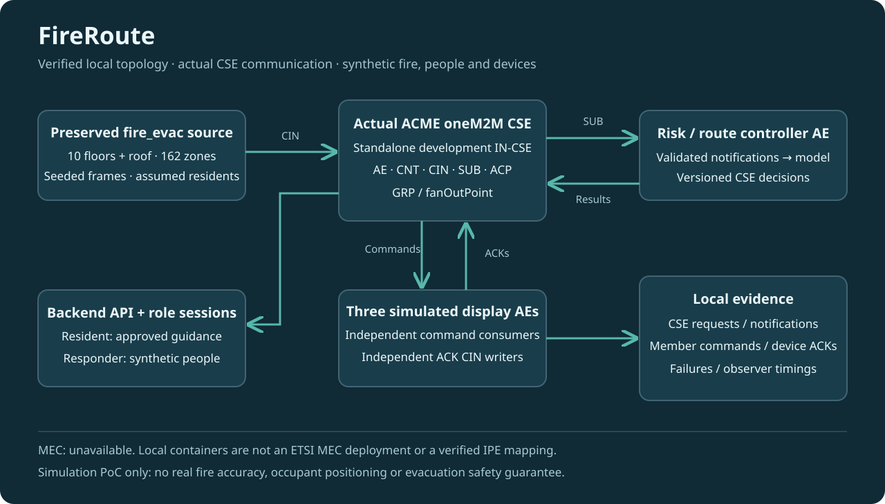
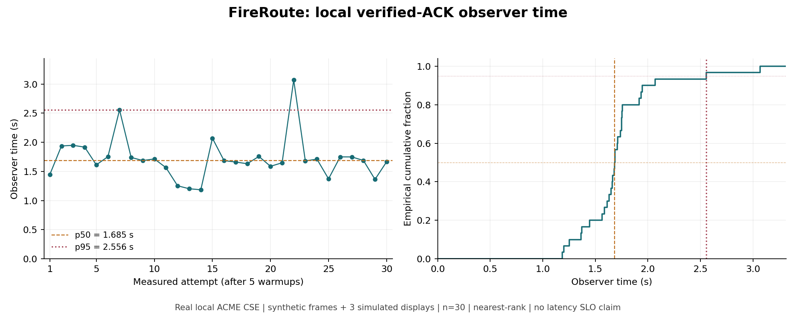
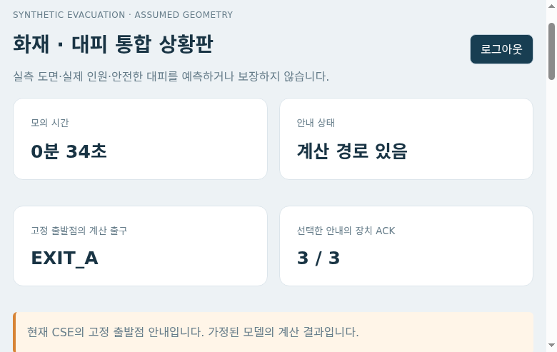
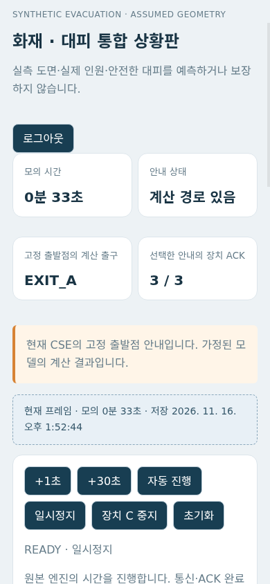

# FireRoute: Coordinating Fire Evacuation Guidance with Real oneM2M Services

FireRoute is a simulation-based hackathon proof of concept exploring how IoT observations can produce coordinated evacuation guidance and separate resident and responder views. Its central question is not whether a browser can animate fire. It is whether an application can ingest an observation through an actual oneM2M CSE, compute a consistent decision, distribute it through a standard service, and independently verify which simulated devices applied it.

This manuscript describes the verified local system. It has not been published to Hackster. Published commit efc65cb passes all 19 local stages from a clean Git archive, with a separate 51-check source/protocol review and readable Korean browser samples. This reproduces the source on the same local host; remote CI and a different machine are unverified. The separate certificate-bound CSE gate passes 11 actual checks on pushed aa79ace; an 18-check reviewer correlates native CSE traffic/callbacks and eight public certificates. Its backend/callback HTTP and main-scenario/MQTT migration remain explicit limits. MEC011 discovery/application-AE catalog still requires an actual endpoint; deployment, standardized MEC-IPE and service integration are unverified. No edge-latency advantage is claimed. Actual video, final editorial review and publication remain unfinished.

## What the prototype contains

The demonstrated environment is WSL2 Ubuntu with Docker Compose, ACME oneM2M CSE 2026.5.1, Python 3.12.16 and a buildless HTML/CSS/JavaScript dashboard. Node 24.22.1 exports deterministic source traces. No physical Raspberry Pi, temperature sensor, occupant-positioning hardware or actuator is required for the verified baseline. Three separate Python processes represent display devices, each with its own AE identity, subscription and ACK writer.

The user-supplied fire_evac model covers ten floors plus a roof, with 162 zones and two stairwells. Its original seven engine/configuration files remain byte-preserved. Fire and smoke are relative indices; they are not temperatures, smoke concentrations or toxicity measurements. A separately versioned application model adds 170 synthetic residents, assumed geometry, walking speeds, departure delays and link capacity. Those assumptions are not calibrated to a real building.

## Why oneM2M matters in this system

ACME is the actual service layer, not a custom application REST server renamed as a CSE. Sensors, the controller, displays and consuming applications register as AEs. Containers organize observations, decisions, commands and responses; contentInstances retain versioned application payloads.

Subscriptions deliver real CSE verification requests and notifications. The application persists and validates a notification before accepting its event into the model. This supplies a standard event mechanism rather than a browser directly triggering an unrelated animation.

The controller uses a Group whose members are the three command containers. A CREATE at its fanOutPoint requests distribution through the CSE. The coordinator inspects every member result and reads back each resulting command contentInstance. Outer aggregate success is insufficient: each device must independently consume its command, apply it and create its own correlated ACK contentInstance. The controller cannot manufacture an ACK to make a missing display appear healthy.

AccessControlPolicies restrict supported local resource operations. Residents receive approved guidance, while the responder role can access synthetic remaining-person information. Actual forbidden requests are tested against the CSE, and application authorization also rejects resident access to responder endpoints. The verified baseline still uses private local HTTP and header originators; that is not full originator authentication or secure transport evidence.

## From a source frame to a display

Each complete 162-zone frame carries an event ID, incident ID, sequence, source manifest hash, simulation second and actual UTC observation time. The source creates a real CSE contentInstance and reads it back. A matching durable subscription notification is required before the controller advances the model.

Routing uses the shared graph and the explicitly assumed blocking policy. The risk layer excludes policy-blocked and collapsed nodes, computes a path or NO_VERIFIED_ROUTE, and saves correlated route/hazard records in the CSE. It keeps the fixed guidance query separate from private moving-resident snapshots. Three signs announce the common fixed-origin result; they do not display every resident's individual route.

A no-route command clears old directions. Expired or unavailable observations produce STALE or UNKNOWN, with no current direction or invented occupant count. A responder may inspect a protected historical snapshot, clearly labeled with its original observation time. Historical positions never become current measurements simply because the screen polls again.

## What was actually tested

The selected natural-hazard run accepted 729 consecutive real CSE frame contentInstances and matching notifications. At simulated second 466 the fixed query used an alternative avoiding blocked stair F4-SA. The alternate still reached EXIT_A: a changed path, rather than an exit-name change, is the evidence. At second 600 a collapsed room was excluded from traversal. At second 727 the fixed origin was isolated and guidance was cleared.

Five Group operations produced 15 command contentInstances. Devices independently produced 14 ACKs. The final delivery intentionally stopped display-c, resulting in two ACKs and INCOMPLETE. That expected incomplete delivery passed the test because the system identified the missing device. Under this scenario's assumptions all residents had already evacuated by the late hazard queries; this is not a trapped-person rescue demonstration.

The fault gate separately passed 56 checks: malformed or conflicting payloads, duplicate and out-of-order events, source expiry, and an explicitly injected API read-link failure. Invalid data did not advance the model or erase known hazards. Controlled CSE stop/start was then tested while application and display processes survived. Eight host and 52 child checks verified expiry during the outage, retained CSE resource identities and same-incident recovery with new input and independent ACKs. Application-process restart, crash durability and partial-fan-out recovery are outside that result.

## Measurement with an explicit boundary

The actual local observer benchmark completed five warmups and 30 measured attempts, with no incomplete or failed attempt. Including warmups, it verified 35 Group operations, 105 command contentInstances and 105 independently written ACK contentInstances.

| Observer duration, N=30 | p50 | p95 |
|---|---:|---:|
| Source submission to verified three-device ACKs | 1684.876 ms | 2556.166 ms |
| Source submission through public-status commit | 2037.361 ms | 3109.567 ms |

These durations use one coordinator's monotonic clock and include CSE traffic, model work, polling, verification and native evidence storage. They exclude browser rendering and are not synchronized physical sensor-to-device timing. Percentiles use nearest rank over raw integer nanoseconds; five warmups are retained but excluded from statistics. A separate 23-check artifact review independently reproduced the statistics and checked source/notification/Group/device correlations. No latency SLO or MEC speedup follows from this baseline.

The [performance report](../PERFORMANCE.md) includes the curated CSV, provenance and recalculation command. [STATUS](../STATUS.md) indexes original private run IDs and distinguishes actual execution, read-only evidence review and unit fixtures.

## Reproduce and extend

Clone [the FireRoute repository](https://github.com/gaevalja/fire-route), select a reviewed commit, install the documented Docker/Node prerequisites and follow the root README. Start the local dashboard with `make demo-scenario-up`; open http://127.0.0.1:3001/. Operator role codes remain in the ignored .runtime/access-codes.json file and must not appear in recordings.

`make verify-local` runs the serial acceptance plan in a separate Compose project. After committing reviewed changes, `make verify-clean` extracts that commit into an isolated directory and repeats the plan without copying local secrets or generated traces. A failure or blocked environment stays explicit; the presence of a command is not a passing result. See [the acceptance runbook](../LOCAL_ACCEPTANCE.md).

The separate standards gate passes nine real-CSE checks for eight-AE namespace discovery/read-back, a negative empty search, and a oneM2M MQTT CREATE/RETRIEVE confirmed through HTTP/subscription and actual ACP denials. Original run evidence/20261115-134325Z-aab15d43/ has a separate 13-check wire review. MQTT broker PUBACK is never a contentInstance response or a display ACK.

Clean-archive acceptance evidence/20261116-044349Z-18300187/ passes all 19 stages on efc65cb, with zero unattempted steps and cleanup exit 0. Each HTTP/HTTPS Chrome flow passes 20 checks spanning role isolation, resident selection, SVG movement, reset, advancement, ACK rendering, pause, expiry/history, narrow layout and logout. The separate 51-check read-only review matches every committed regular file and correlates both browser incidents to actual CSE frame/subscription, Group command and independently device-written ACK evidence. Eight HTTPS checks verify TLS 1.3, the local CA/hostname, rejection of an untrusted CA, role sessions, secure cookie flags and CSP. The anonymous isolated MQTT broker and header-originator main CSE remain outside that browser/API TLS boundary. The isolated certificate-bound profile has separate T36 proof; it is not main-scenario migration. [Curated result](../assets/local-acceptance-20261116.json) preserves the exact commit, counts and limits. The earlier working-tree result and 57-check review remain retained separately.

Unedited HTTP responder status from the clean run, at simulation second 34: a computed EXIT_A route and three independent device ACKs. This status view uses synthetic input and does not show the later hazard stages or the map below the captured viewport.

Unedited HTTPS view at 390 pixels wide, simulation second 33. The private Korean font is readable; no role codes or private keys are shown. These reviewed still images are not a recorded/narrated video, remote CI, public release or final submission.

FireRoute's risk worker is independently executable and packaged for later integration, but it is custom application logic, not itself an ETSI MEC service. A future permitted MEC integration must verify actual deployment interfaces, service availability and any MEC-IPE mapping. Until then the product displays MEC unavailable.

The benefit demonstrated today is standard service-layer coordination with traceable resource operations, independently observed device completion and explicit failure states. FireRoute remains an uncalibrated simulation PoC. It does not guarantee real fire detection, real occupant positions or safe evacuation.
